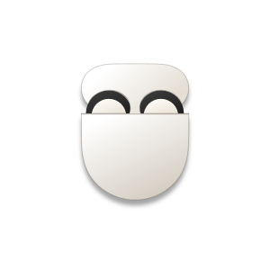

<p align="center">
    
</p>

<h1 align="center">
    MuggleBuds
</h1>

<p align="center">
    A Windows 11 tray app that controls Nothing CMF Buds Pro 2 from a native WinUI flyout.
</p>

## Introduction

MuggleBuds puts the controls from [ear-web](https://github.com/radiance-project/ear-web) in your tray. It talks to the buds over Bluetooth directly, so you don't need a browser or the Nothing X app open. It is a CMF Buds Pro 2 port of [MagicBuds](https://github.com/artistro08/MagicBuds).

- **Flyout:** each bud and the case in a battery ring, and the four noise modes: Noise Cancellation, Off, Adaptive and Transparency. While Noise Cancellation is on, a slider sets its level: Low, Medium or High.
- **Settings › Audio Settings:** listening mode (Dirac Opteo, Pop, Rock, Classical, Electronic, Enhance vocals and Custom), noise cancellation level, in-ear detection, low latency mode and enhanced bass.
- **Settings › Shortcuts:** switch noise modes from anywhere in Windows. Win+F10 is Noise Cancellation, Win+F11 Adaptive, Win+F12 Transparency and Win+F6 Off, and you can change or clear each one.
- **Settings › Devices:** pick your buds' color so the pictures match.
- **Settings › App:** low battery notifications, start at sign-in, light and dark themes, and an option to keep the tray icon next to the clock while your buds are connected and tuck it away when they aren't.

> Only one app can hold the buds' control link at a time. Close ear-web and anything else that controls the buds before switching to MuggleBuds.

## Pictures

Pictures of the buds belong to Nothing, so none are included and the app shows an icon until you add your own. Put transparent PNGs in `src\MuggleBuds.App\Assets`, named for the color you pick in Settings › Devices (Black, Blue, Orange or White):

| File | Size |
| --- | --- |
| `CMF Buds Pro 2 <Color>.png` (both buds) | 400 x 299 |
| `CMF Buds Pro 2 <Color> Left.png` | 256 x 256 |
| `CMF Buds Pro 2 <Color> Right.png` | 256 x 256 |
| `CMF Buds Pro 2 <Color> Case.png` | 299 x 377 |

The colors are listed in `HeadsetViewModel.BudsColors`. Pictures keep their proportions, so the sizes are a guide.

## Building From Source

### Prerequisites

- Windows 11 22H2 or newer
- .NET 10 SDK
- Visual Studio 2026 with the .NET desktop development workload and the Windows App SDK C# templates (only needed for packaging)

### Building

Build everything and run the tests:

```powershell
.\scripts\Build.ps1
```

If PowerShell refuses to run scripts, use `powershell -ExecutionPolicy Bypass -File .\scripts\Build.ps1`.

To close a running copy cleanly first (it lets go of the buds properly, which a killed process can't):

```powershell
.\src\MuggleBuds.App\bin\x64\Debug\net10.0-windows10.0.26100.0\win-x64\MuggleBuds.exe --quit
```

### App Icons

The tray icons, the app icon and every package logo are drawn from `assets-src\buds.svg`. After changing it, run:

```powershell
pwsh -STA -File .\scripts\New-AppAssets.ps1
```

### Packaging

1. Once, from an elevated PowerShell, create and trust the signing certificate:

    ```powershell
    .\scripts\New-DevCertificate.ps1
    ```

2. Build the signed MSIX packages only:

    ```powershell
    .\scripts\Build-Package.ps1
    ```

    Or build every release file (MSIX and MSI, x64 and ARM64, plus the certificate) into `artifacts\release`:

    ```powershell
    .\scripts\Build-Release.ps1 -Version 1.0.0.0
    ```

## Documentation

How the CMF Buds protocol is used, and what has been checked on real buds, is in [docs/protocol/cmf.md](docs/protocol/cmf.md). The notes for Pixel Buds, from MagicBuds, are in [docs/protocol/notes.md](docs/protocol/notes.md).

## Reporting Problems

Turn on Settings › App › Debug logging, reproduce the problem, then use Open log folder and attach the newest `.log` to the issue. Every message sent to and from the buds is in it.

## License

AGPL-3.0, see [LICENSE](LICENSE). Notices for the work it builds on are in [LICENSE-THIRD-PARTY](LICENSE-THIRD-PARTY):

- The interface and app mechanics are from [MagicBuds](https://github.com/artistro08/MagicBuds) (MIT).
- The CMF Buds protocol details are based on [ear-web](https://github.com/radiance-project/ear-web) (AGPL-3.0).
- The Pixel Buds code left over from MagicBuds is based on [pbpctrl](https://github.com/qzed/pbpctrl) (MIT).
- The shortcut picker is ported from [PowerToys](https://github.com/microsoft/PowerToys) (MIT).
- Three of the noise mode icons are [Material Symbols](https://fonts.google.com/icons) (Apache 2.0).

## Disclaimer

MuggleBuds is an independent app and is not made, endorsed, or supported by Nothing or Google. Nothing and CMF are trademarks of Nothing Technology Limited. Pixel, Pixel Buds, and Google are trademarks of Google LLC.
